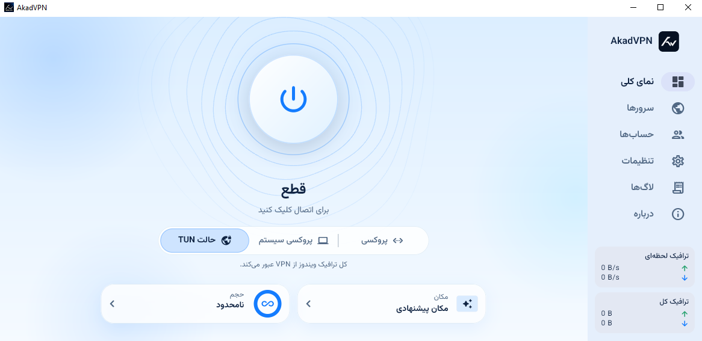
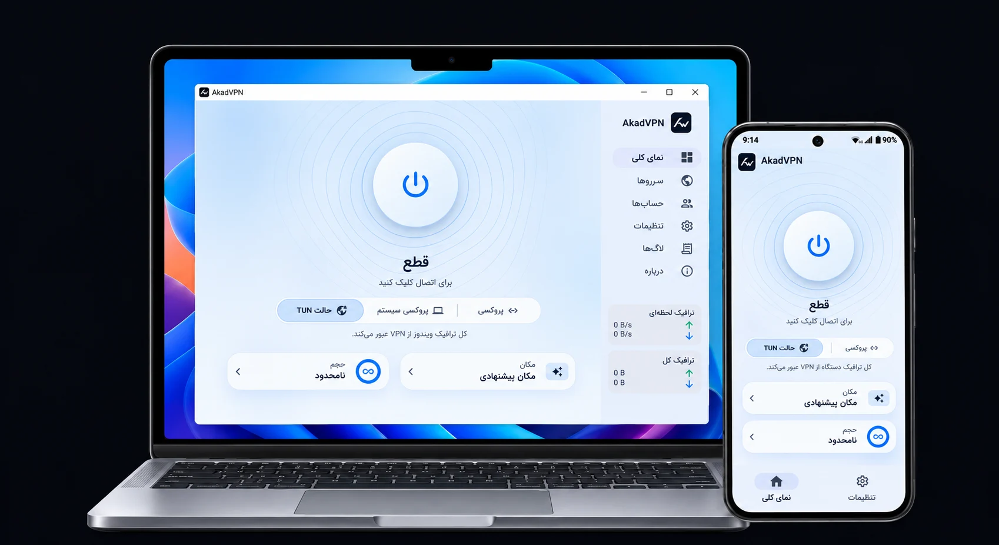
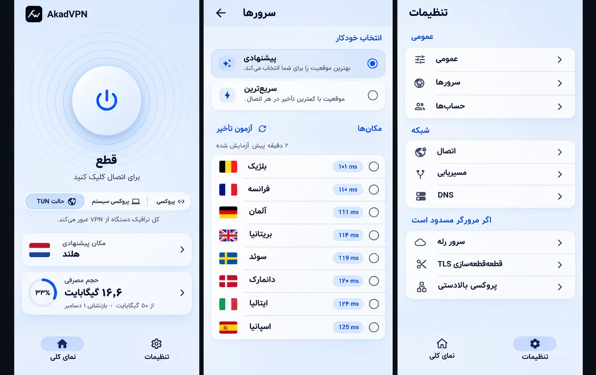
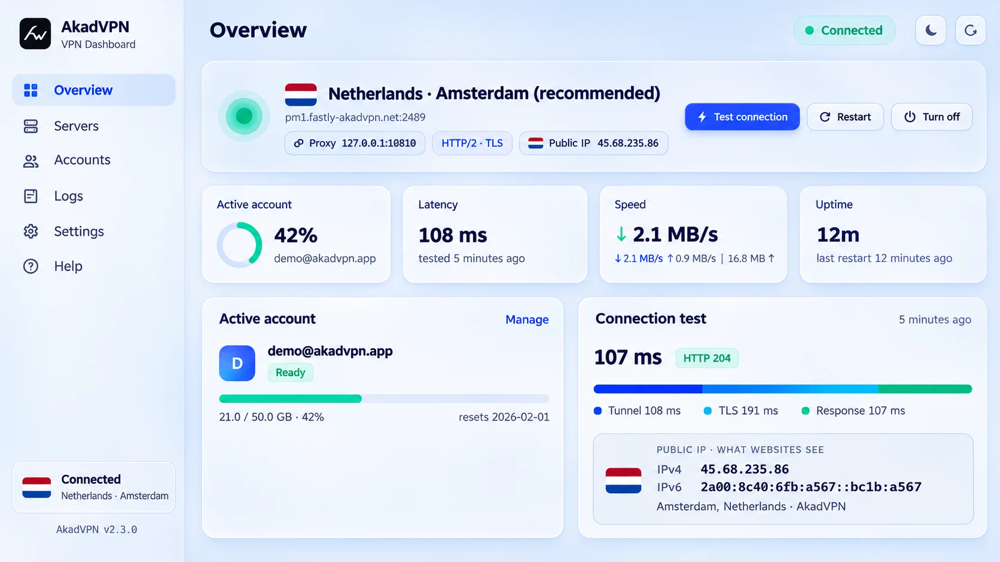

<div align="center">

**🇺🇸 English** &nbsp;/&nbsp; [🇨🇳 简体中文](docs/readme/README_zh.md) &nbsp;/&nbsp; [🇷🇺 Русский](docs/readme/README_ru.md) &nbsp;/&nbsp; [🇮🇷 فارسی](docs/readme/README_fa.md)

</div>
<br>

<p align="center"></p>

<h1 align="center">AkadVPN</h1>

> **AkadVPN fork:** This is an independently rebranded derivative of
> [Arman VPN](https://github.com/armanlife/arman-vpn-client), distributed
> under the GNU GPLv3. Original copyright and license notices are retained.
> AkadVPN is not affiliated with Mozilla or the original project's maintainers.
> Before publishing builds, configure your actual GitHub repository and
> signing secrets using [the release guide](docs/AKADVPN-RELEASE.md).

### Akad Web theme

AkadVPN includes an Akad Web-inspired navy/blue identity across the Flutter
Android/Windows/macOS/Linux interfaces and the browser dashboard: cobalt-to-cyan
accents, glasslike panels, rounded controls, and coordinated dark/light palettes.
The connection engine and account handling are not modified by this theme.
The interface continues to use bundled Inter/Vazirmatn fonts; proprietary Peyda
font files are not included.

### Akad Web logo assets

The application icon uses the supplied `app/assets/branding/akad-icon-source.png`.
The separate transparent white in-app mark is
`app/assets/branding/akad-logo-white-source.png`. Both originals are retained
unchanged. To regenerate app icons, Android TV artwork, Windows/macOS/Linux
resources, notification icon, tray indicators and dashboard logos, run
`python3 app/tool/app_icons.py` from the repository root.

<p align="center"><b>Unofficial project.</b> AkadVPN is an independent project. It is not made, owned, sponsored, or endorsed by Mozilla, and is not affiliated with Mozilla in any way. See the <a href="#disclaimer">disclaimer</a>.</p>

<div align="center">

[](https://github.com/itpo8/akad-vpn/releases)
[](https://github.com/itpo8/akad-vpn/releases/latest)
[](LICENSE)
[](https://t.me/AkadVPNClient)

</div>

## What is AkadVPN?

**AkadVPN** is a free, open-source VPN that works with a Firefox Account. It carries your internet traffic through Mozilla's servers, on **Fastly**'s infrastructure, over secure **HTTP/1.1, HTTP/2, and HTTP/3** tunnels.

For **Android, Windows, macOS, and Linux**; completely free, with no ads.

<p align="center"></p>

<p align="center"></p>

<p align="center"><sub>Device preview is an illustrative mockup, not a capture from running apps.</sub></p>

## 🚀 Main features

✈️ Cross-platform: Android, Windows, macOS, and Linux

📺 Android TV: works with the remote control

⭐ Very easy to use, with a simple interface

🆓 Free: 50 GB a month for every Firefox Account

🌐 Mozilla's servers: choose a country with a ping test, or let the app pick the best server

⚡ Fast, stable connections over HTTP/1.1, HTTP/2, and HTTP/3

🦊 Looks like Firefox: connections to Mozilla start with Firefox's own TLS fingerprint (uTLS)

🔀 Smart routing (split tunneling): choose the sites and apps that skip the VPN

🧱 If your network blocks the connection: TLS fragmentation, upstream SOCKS5 proxy, and a [relay server](docs/relay/README.md)

💾 Backup and import: your accounts and settings in one file, for another device or a server

⚙️ Advanced connection options: IPv4, IPv6, or dual-stack, and a custom MTU

🔒 Encrypted DNS (DNS over HTTPS)

🌍 15 languages, including English, Persian, Chinese, and Russian

🌙 Light and dark themes

🛡 Open source, secure, and community-driven

🔄 Automatic updates

## 📸 Screenshots

<p align="center"></p>

The desktop capture above is authentic. Mobile screens are illustrative previews; real phone screenshots will be added after testing on a device.

## 📥 Download

<table>
<thead>
<tr><th>System</th><th>Download</th></tr>
</thead>
<tbody>
<tr><td>Android</td><td><a href="https://github.com/itpo8/akad-vpn/releases/latest/download/AkadVPN-Android-universal.apk"></a><br><a href="https://github.com/itpo8/akad-vpn/releases/latest/download/AkadVPN-Android-arm64-v8a.apk"></a><br><a href="https://github.com/itpo8/akad-vpn/releases/latest/download/AkadVPN-Android-armeabi-v7a.apk"></a><br><a href="https://github.com/itpo8/akad-vpn/releases/latest/download/AkadVPN-Android-x86_64.apk"></a></td></tr>
<tr><td>Android TV</td><td><a href="https://github.com/itpo8/akad-vpn/releases/latest/download/AkadVPN-Android-universal.apk"></a></td></tr>
<tr><td>Windows</td><td><a href="https://github.com/itpo8/akad-vpn/releases/latest/download/AkadVPN-Windows-Setup-x64.exe"></a><br><a href="https://github.com/itpo8/akad-vpn/releases/latest/download/AkadVPN-Windows-x64.zip"></a></td></tr>
<tr><td>macOS</td><td><a href="https://github.com/itpo8/akad-vpn/releases/latest/download/AkadVPN-macOS.dmg"></a></td></tr>
<tr><td rowspan="2">Linux</td><td><a href="https://github.com/itpo8/akad-vpn/releases/latest/download/AkadVPN-Linux-amd64.tar.gz"></a><br><a href="https://github.com/itpo8/akad-vpn/releases/latest/download/AkadVPN-Linux-arm64.tar.gz"></a></td></tr>
<tr><td><a href="https://github.com/itpo8/akad-vpn/releases/latest/download/akad-vpn-core-linux-amd64.tar.gz"></a><br><a href="https://github.com/itpo8/akad-vpn/releases/latest/download/akad-vpn-core-linux-arm64.tar.gz"></a></td></tr>
</tbody>
</table>

**Which file should I download?**

- **Android:** if you are not sure, take **Universal**; it installs on every phone. **ARMv8** is for most of today's phones and is smaller.
- **Windows:** **Setup** is a normal installer; **Portable** needs no install and runs from any folder.
- **Linux:** **App** for a Linux desktop (with a graphical environment); **Core** for a server (without a graphical environment, with a web panel).
- **A server, in Docker:** the core image from the same release tag. See [Docker](#docker).

## 💻 Install and update on Linux and macOS

> Windows and Android users don't need this section: take the installer from the "Download" table above.

```bash
curl -fsSL https://raw.githubusercontent.com/itpo8/akad-vpn/main/install.sh | bash
```

### 🌐 Web panel

For Linux servers, AkadVPN has a **web panel** that opens in any browser and has everything the app has: managing accounts and data, choosing a server and testing delay, the connection test, the live log, and every setting.

<p align="center"></p>

Illustrative web dashboard with sample values; not a live connection screenshot.

- **Panel address:** `http://SERVER-IP:10820/app/`, with a username and password. The exact address is shown at the end of the install.
- **Proxy:** SOCKS5 and HTTP on port `10810`, with a username and password of its own.

### ⌨️ Managing from the terminal

On the server, run `sudo akad-vpn` to open the management menu:

```text
$ sudo akad-vpn

  AkadVPN
  ────────────────────────────────────────────────────────────────────────────
    Service     ● running
    Autostart   on
  ────────────────────────────────────────────────────────────────────────────
   0) Exit
  ────────────────────────────────────────────────────────────────────────────
   1) Update                                   akad-vpn update
   2) Uninstall                                akad-vpn uninstall
  ────────────────────────────────────────────────────────────────────────────
   3) Set panel login                          akad-vpn panel
   4) View panel info                          akad-vpn panel-info
  ────────────────────────────────────────────────────────────────────────────
   5) Status                                   akad-vpn status
   6) Start                                    akad-vpn start
   7) Stop                                     akad-vpn stop
   8) Restart                                  akad-vpn restart
   9) Show the log                             akad-vpn logs
  ────────────────────────────────────────────────────────────────────────────
  10) Enable autostart                         akad-vpn enable
  11) Disable autostart                        akad-vpn disable
  ────────────────────────────────────────────────────────────────────────────
  12) Add a Firefox Account                    akad-vpn add-account
  13) List the accounts                        akad-vpn list-accounts
  ────────────────────────────────────────────────────────────────────────────
  Enter a number [0-13]:
```

## OpenWrt routers

To install on an OpenWrt router, see the [OpenWrt guide](docs/OPENWRT.md).

## Docker

The Linux core (the proxy and the web panel) is also a container image. A release tag `vX.Y.Z`, the same tag as the downloads above, publishes `ghcr.io/<owner>/<repository>:<version>`, plus the `v` form, the major and minor, and `latest`. The owner and repository are the GitHub repository that runs the workflow. The example uses the upstream name.

```bash
docker run -d --name akad-vpn --restart unless-stopped \
  -p 10820:10820 -p 127.0.0.1:10810:10810 \
  -v akad-vpn:/var/lib/akad-vpn \
  ghcr.io/itpo8/akad-vpn:latest
```

The first start prints a panel login and a proxy login. Accounts and settings stay in the `akad-vpn` volume. See the [Docker guide](docs/DOCKER.md).

## Known limitations

<details>
<summary>What Mozilla's servers do not carry</summary>

- **TCP:** ports 80, 443, 8080, and 8443 only. Other ports, such as mail (25, 465, 587, 993) and SSH (22), are refused. Git over SSH to GitHub is the exception: it goes through port 443 by itself.
- **UDP:** ports 80, 443, 3478, 8080, 8443, and 49152-65534 only. Calls and games on other ports do not go through. Browsers and most apps work normally.

</details>

## Disclaimer

This app is an independent, unofficial client, made and maintained by its own developer. It is not a Mozilla product: Mozilla did not make it, does not own, sponsor, or endorse it, and has no part in its development or support. Questions and problems about the app belong in this repository, not with Mozilla.

You sign in with your own Mozilla account. The account's terms, data limit, and availability are set by Mozilla. Your password and sign-in tokens stay on your device.
